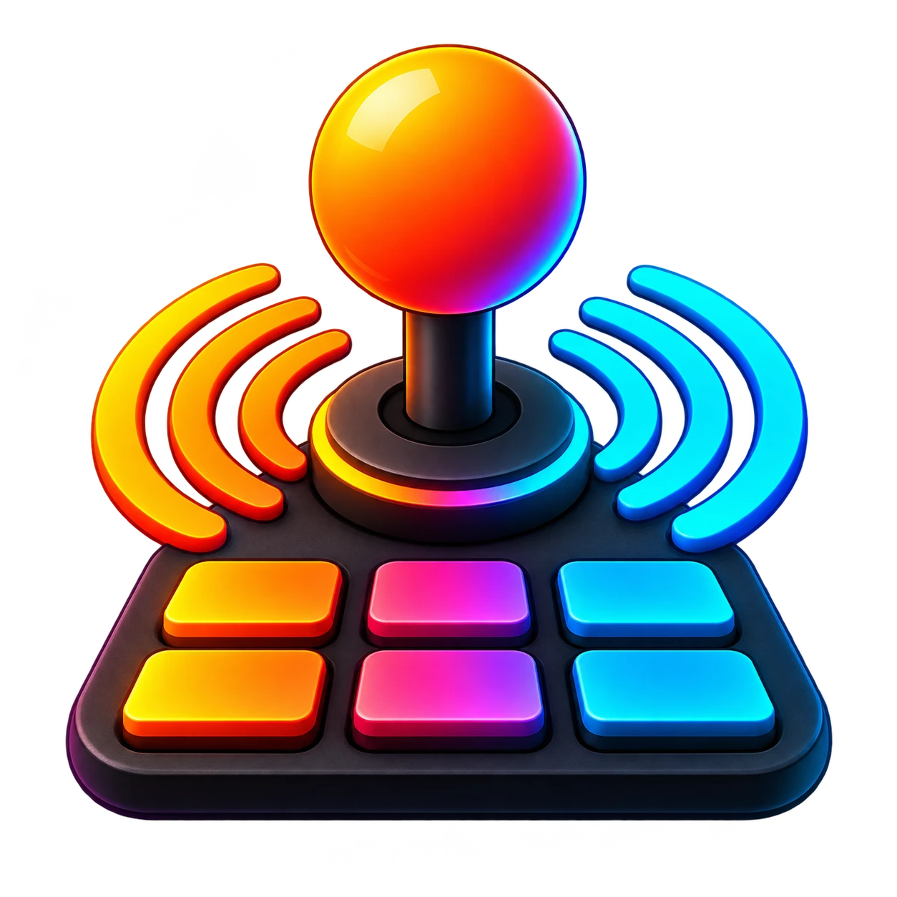

<p align="center">
  
</p>

# Arcadia

> **A browser-based musical instrument and beat-making studio you play with game controllers.**

Arcadia transforms standard gaming controllers (PlayStation DualSense & DualShock, Xbox Wireless, Nintendo Switch Pro, and generic PC gamepads) into an expressive, tactile musical instrument and beat-production workstation. It combines console gaming responsiveness with the sound design and sampling workflow of modern beat-making hardware (MPC, SP-404, OP-1) and digital audio workstations.

Arcadia runs completely inside the browser with zero external DAW, plugin host, or cloud backend required.

---

## Highlights

- **Sub-35ms Latency**: Real-time Gamepad API polling loop running on `requestAnimationFrame` with zero hot-path memory allocations and immediate Web Audio synthesis.
- **Up to 4 Simultaneous Players (P1–P4)**: Each player slot has an independent sound engine, instrument preset, controller mapping, scale, effects rack, and expression setup.
- **6 Built-in Instrument Engines**:
  - **Subtractive PolySynth**: Dual oscillators with sub & noise, resonant 24dB/oct ladder filter, and dual ADSR envelopes.
  - **4-Operator FM Synth**: Multi-algorithm frequency modulation with editable harmonic ratios and modulation indices.
  - **Wavetable & Retro Chiptune**: Authentic NES, Game Boy, and Commodore SID waveforms with pulse-width modulation and arpeggiator.
  - **Granular Texture Engine**: Grain size, spray, density, and scrub parameters for ambient textures and soundscapes.
  - **Chromatic Sampler**: Polyphonic sample playback with root pitch detection, looping, envelope, and filter controls.
  - **10-Pad Drum Machine**: MPC/SP-404 style 10-pad layout with choke groups, pitch tuning, transient slicing, and velocity curves.
- **Interactive Waveform Editor & Beat Slicer**: Zoom, scrub, trim start/end points, normalize, reverse, and one-click auto-chop transients across the 10 gamepad buttons.
- **14-Slot Insert Effects Rack**: Tape saturation, stereo ping-pong delay, algorithmic reverb, bitcrusher, auto-filter, 3-band EQ, compressor, chorus, phaser, tremolo, ladder filter, and live beat stutter / roll buffer.
- **Tactile Controller Visualizer**: Hardware-device dark interface featuring a responsive SVG controller diagram that illuminates in real time with button strikes and analog trigger depth.
- **Expressive Motion & Modulation**: Dual assignable LFOs, 4 multi-destination macro controls, analog thumbstick pitch bending / filter sweeps, and DualSense gyroscopic tilt and dynamic light bar via WebHID.
- **Performance Recording & Multi-Format Export**: Record uncompressed audio takes and replayable event logs, loop live, and export to pristine WAV, WebM, and Standard MIDI Files (.mid).
- **Physical Keyboard Fallback**: Play using your computer keyboard (`A S D F G H J K L ;`) with togglable on-screen key badges and hints.

---

## Supported Controllers

| Controller                       | Connection                        | Profile Status  | Special Capabilities                             |
| :------------------------------- | :-------------------------------- | :-------------- | :----------------------------------------------- |
| **Sony DualSense (PS5)**         | USB / Bluetooth                   | Native Standard | Analog triggers (L2/R2), WebHID tilt & light bar |
| **Sony DualShock 4 (PS4)**       | USB / Bluetooth                   | Native Standard | Analog triggers, touchpad button                 |
| **Xbox Wireless (One / Series)** | USB / Bluetooth / Wireless Dongle | Native Standard | Impulse triggers, ergonomic thumbstick bend      |
| **Nintendo Switch Pro**          | Bluetooth / USB                   | Native Standard | Inverted face button layout profile              |
| **Generic PC Gamepads**          | USB / Bluetooth                   | Remap Wizard    | Interactive 10-step button & axis calibration    |
| **Computer Keyboard**            | Physical Keyboard                 | Built-in        | Home-row chromatic C1–A1 trigger layout          |

---

## Architecture Overview

```
Arcadia Core Flow:
[ Gamepad API / Keyboard ]
       │
       ▼ (60 Hz rAF / edge detection)
[ GamepadManager / KeyboardInput ] ──► [ liveState ] ──► [ Direct DOM UI ]
       │
       ▼ (Note & Expression events)
[ PerformanceController ]
       │
       ├──► [ AudioEngine (PlayerChannels P1–P4) ] ──► [ MasterBus / Recorder ] ──► Speakers
       ├──► [ EventLog / Take Recorder ] ─────────► [ IndexedDB Storage ]
       └──► [ Web MIDI Out (optional) ] ──────────► External DAW / Synthesizer
```

---

## Quick Start

### Prerequisites

- **Node.js**: `v22.12.0` or higher
- **npm**: `v10` or higher
- A Chromium-based browser (Google Chrome, Microsoft Edge, Brave) is recommended for full WebHID and Gamepad API feature support.

### Installation

```bash
# Clone the repository
git clone https://github.com/hasanify/arcadia.git
cd arcadia

# Install dependencies
npm install

# Start local development server
npm run dev
```

### Development Scripts

- `npm run dev`: Start Vite development server at `http://localhost:5173`
- `npm run build`: Typecheck and produce optimized static production bundle in `dist/`
- `npm run preview`: Preview the production build locally
- `npm run typecheck`: Run TypeScript compiler checks
- `npm run lint`: Run ESLint across code and tests
- `npm run format`: Format code with Prettier
- `npm run test`: Run unit and integration tests with Vitest
- `npm run coverage`: Run test suite with v8 coverage reports
- `npm run e2e`: Run end-to-end browser tests with Playwright

---

## License

MIT © [hasanify](https://github.com/hasanify)
